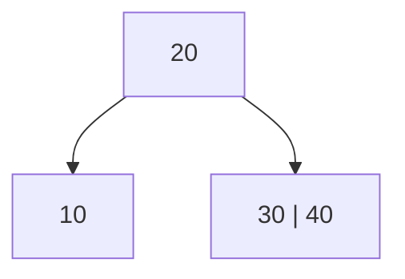

A **2-3-4 tree** is a search tree whose nodes hold one, two, or three keys, and which grows only at its root, so every leaf is always at the same depth and the tree is perfectly balanced.

A 2-3-4 tree has three kinds of node, named for how many children each has:

| Node | Keys | Children, in order |
|---|---|---|
| **2-node** | $k_1$ | Keys less than $k_1$, and keys greater than $k_1$, as in a [[Binary Search Tree\|BST]] |
| **3-node** | $k_1 < k_2$ | Less than $k_1$, between $k_1$ and $k_2$, and greater than $k_2$ |
| **4-node** | $k_1 < k_2 < k_3$ | Less than $k_1$, between $k_1$ and $k_2$, between $k_2$ and $k_3$, and greater than $k_3$ |

Within a node, the keys are in order, smallest on the left. A node is a leaf, with no children, or has all of its children.

**Lookup** works as in a BST: in each node, compare the key with the node's keys, and follow the child whose range contains it.

**Insertion** always adds the key to a leaf, never creating a new leaf below one. Walking down from the root, whenever the walk reaches a 4-node, it **promotes** that node's middle key: the middle key moves up into the parent, and the two outer keys become separate 2-nodes, its children. Since every 4-node met on the way down is split, the parent always has room for the promoted key. When the walk reaches the leaf where the key belongs, the leaf is a 2-node or a 3-node, and the key is added to it, making a 3-node or a 4-node. Promoting the root's middle key creates a new root above it, which is the only way the tree gets taller, so every leaf stays at the same depth.

Since every path from the root to a leaf has the same length, and each node has at least two children, the height is $\Theta(\log n)$. So lookup and insert take $O(\log n)$ time, and insertion always reaches a leaf, so it takes $\Theta(\log n)$. Only a lookup can finish early, in $\Theta(1)$, if the key is at the root.

Three kinds of node are awkward to implement, so a 2-3-4 tree is usually **binarized**: each 3-node or 4-node is redrawn as a small BST of two or three nodes, with the edges inside it marked so the original can be read back. A 4-node $k_1, k_2, k_3$ becomes $k_2$ with children $k_1$ and $k_3$, which is exactly what promoting it does. A 3-node has two choices, with either key on top. The binarized tree isn't perfectly balanced, but its height is still $\Theta(\log n)$, at most twice the 2-3-4 tree's, and binarizing with colors instead of marked edges is a [[Red-Black Tree|red-black tree]].

More generally, a 2-3-4 tree is a **B-tree** of order 4. B-trees, introduced by Rudolf Bayer and Edward McCreight in 1970, allow many keys per node, which suits disks and databases, where reading one large node costs about as much as reading a small one. The **2-3 tree** (John Hopcroft, 1970) is the version without 4-nodes.

# Example

For illustration (an example not from the source), inserting $10$, $20$, $30$, then $40$:

1. $10$, $20$, and $30$ go into the root, a leaf, which becomes the 4-node $[10, 20, 30]$.
2. Inserting $40$ starts at the root, a 4-node, so its middle key $20$ is promoted into a new root, with children $[10]$ and $[30]$.
3. $40$ is greater than $20$, so it goes to the leaf $[30]$, which becomes the 3-node $[30, 40]$.

Both leaves are at depth $1$: the tree grew taller at the root, not below a leaf.

# Connections

- [[Red-Black Tree]]: a 2-3-4 tree in binary form, with colors marking which nodes belong together
- [[Binary Search Tree]]: a 2-3-4 tree made only of 2-nodes
- [[Tree (Data Structure)]]: height and balance
- [[Search Tree Comparison]]: how strict balance compares with randomized and splay trees

# Sources

- [[Data Structures & Program Development (HMC CS70)]]

# Maps

![[Map.base#Maps]]
