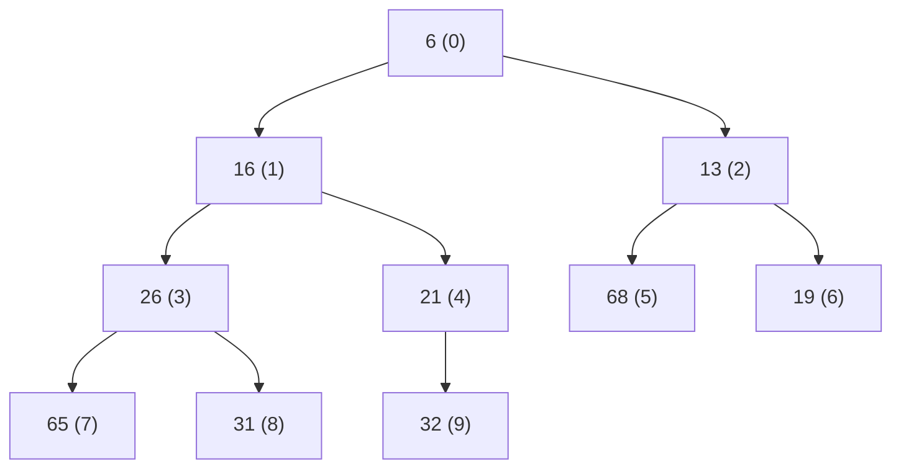

A **binary heap** is a [[Tree (Data Structure)|binary tree]] that is complete and in which every node's key is at least as small as its children's, so the smallest key is always at the root.

A binary heap has two properties:

1. **Structure property:** the tree is **complete**: every level is full except possibly the last, which is filled from left to right.
2. **Order property:** in a **min-heap**, the key in every node is at least as small as the keys of all its children, so each node's key is the smallest in its subtree. A **max-heap** reverses this, with the largest key at the root.

Every subtree of a heap is a heap too. Unlike a [[Binary Search Tree|binary search tree]], a heap's order is only *vertical*, between a node and those below it: whether a key is in the left or right subtree says nothing about its size. That's why a heap can find the minimum quickly but can't search for an arbitrary key.

A binary heap is the most common encoding of a [[Priority Queue|priority queue]].

## Encoding as an Array

A complete tree has no gaps, so a heap is usually stored in an [[Array (Data Structure)|array]] rather than as linked nodes: listing the nodes level by level, left to right, gives each node an index, starting from $0$ at the root. The node at index $i$ then has:

- its left child at index $2i + 1$,
- its right child at index $2i + 2$, and
- its parent at index $\lfloor (i - 1) / 2 \rfloor$.

No pointers are needed, since arithmetic on indices finds every relative.

## Operations

For a min-heap of $n$ items, whose height is $\Theta(\log n)$ because it's complete:

- **GET-MIN** returns the root, index $0$: $\Theta(1)$.
- **INSERT** puts the new key in the next free spot, the end of the array, which keeps the tree complete. Then, while its parent has a larger key, it swaps with the parent, moving up (**sift up**). $O(\log n)$.
- **POP-MIN** replaces the root with the last item, at index $n - 1$, which keeps the tree complete. Removing the root and promoting its smaller child instead would leave a hole and break the structure property. Then, while the moved item is larger than either child, it swaps with its smaller child, moving down (**sift down**), which restores the order property. $O(\log n)$.
- **HEAPIFY** turns an array in arbitrary order into a heap by sifting down every item, from the end of the array to the start. Each sift moves an item to a *higher* index, further down the tree. Leaves have no children, so in practice it starts at the last internal node, index $\lfloor n/2 \rfloor - 1$. It takes $\Theta(n)$ time, not $\Theta(n \log n)$, since most items are near the bottom and sift only a short way.

For a max-heap, swap MIN for MAX and "smaller" for "larger" throughout.

More generally, J. W. J. Williams introduced the binary heap in 1964, as part of [[Heap Sort|heap sort]], and Robert Floyd gave the $\Theta(n)$ heapify the same year. Its cost: at most $\lceil n / 2^{h+1} \rceil$ nodes sit at height $h$, and each sifts down at most $h$ levels, so the total is at most $\sum_{h} h \cdot \frac{n}{2^{h+1}} \le n$. Variants such as $d$-ary heaps, binomial heaps, and Fibonacci heaps trade simplicity for faster operations like merging two heaps or decreasing a key. This heap is unrelated to the heap of memory allocation (see [[Dynamic Memory Allocation]]).

# Examples

## A Min-Heap of Ten Keys

A min-heap of ten keys, with each node's array index:

As an array, it's `[6, 16, 13, 26, 21, 68, 19, 65, 31, 32]`. The children of `16`, at index $1$, are at $2 \cdot 1 + 1 = 3$ and $4$: `26` and `21`. Though `68` is larger than `26`, it's higher up: only parent and child are ordered.

## Popping the Minimum

**POP-MIN** moves the last key, `32`, to the root. Its children are `16` and `13`, so it swaps with the smaller, `13`. At index $2$, its children are `68` and `19`, so it swaps with `19`, and at index $6$ it has no children, so it stops. The heap is now `[13, 16, 19, 26, 21, 68, 32, 65, 31]`, with the new minimum, `13`, at the root, after two swaps for nine items.

# Connections

- [[Priority Queue]]: the interface a binary heap encodes
- [[Tree (Data Structure)]]: complete binary trees, and height
- [[Array (Data Structure)]]: the encoding, with children found by index arithmetic
- [[Heap Sort]]: sorting with a max-heap
- [[Binary Search Tree]]: ordered left to right for search, where a heap is ordered top to bottom
- [[Asymptotic Analysis]]: why heapify is $\Theta(n)$ and not $\Theta(n \log n)$

# Sources

- [[Data Structures & Program Development (HMC CS70)]]

# Maps

![[Map.base#Maps]]
