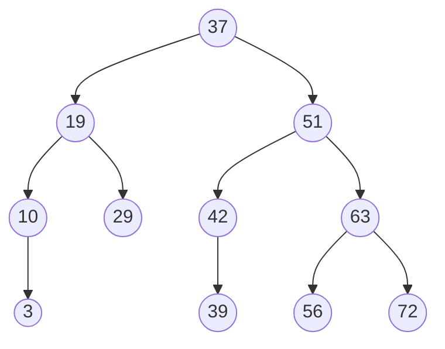

A **binary search tree** (BST) is a [[Tree (Data Structure)|binary tree]] whose keys are ordered: every node's key is greater than every key in its left subtree, and less than every key in its right subtree.

The ordering makes the tree searchable. A BST encodes a [[Set (Abstract Data Type)|set]] by storing each item as a key, never inserting one that's already present, and a [[Associative Array|map]] by storing a value alongside each key.

## Operations

- **Lookup** is binary search. If the node holds the key wanted, it's found. If the key is smaller than the node's, look in the left subtree, and if larger, in the right. An empty subtree means the key isn't there.
- **Insert** follows the same path as a lookup, down to the empty subtree where the key belongs, and replaces it with a new leaf holding the key.
- **Delete** depends on how many children the node has:
  - **None:** remove the node.
  - **One:** remove the node, and move its child up into its place.
  - **Two:** the node's place needs a key that can be the parent of both subtrees. Its **predecessor**, the rightmost node of its left subtree, works, since it's larger than everything else on the left and smaller than everything on the right (and so does its **successor**, the leftmost node of its right subtree). Move that key into the node, and delete it from where it was, which has at most one child.
- **In-order traversal** visits every key in sorted order: recursively visit the left subtree, then the node, then the right subtree. It's a form of depth-first search.

## Cost and Shape

Each operation walks one path from the root, so it takes time proportional to the tree's height $h$, $O(h)$, and the best case, a key at the root, takes $\Theta(1)$. How big $h$ is depends on the order keys were inserted in:

| Shape | Height | Lookup, insert, delete |
|---|---|---|
| **Perfectly balanced**, every node's subtrees of equal height | $\Theta(\log n)$, the shortest possible | $O(\log n)$ |
| **Stick**, every node with at most one child | $\Theta(n)$, the tallest possible, really a [[Linked List\|linked list]] | $O(n)$ |

Inserting keys in sorted order builds a stick, so $m$ inserts into an empty tree take $\Theta(m^2)$ time, the worst case. Keeping the height near $\log n$ whatever the order of insertion takes a balancing strategy, and three approaches give three kinds of guarantee:

- **Randomization**, for expected $\Theta(\log n)$: see [[Randomized Binary Search Tree]].
- **Amortization**, for amortized $\Theta(\log n)$: see [[Splay Tree]].
- **Strict balance rules**, for worst-case $\Theta(\log n)$: see [[2-3-4 Tree]] and [[Red-Black Tree]].

All three rearrange the tree with [[Tree Rotation|tree rotations]], which change its shape but keep its order. How they compare is in [[Search Tree Comparison]].

More generally, BSTs date to the early 1960s, and balanced BSTs underlie the ordered maps and sets of most standard libraries (e.g., C++'s `std::map`). A BST keeps its keys sorted, which a hash table doesn't, so it can also answer questions like "the smallest key greater than $x$" efficiently. Allowing duplicate keys needs a convention, such as sending equal keys right, which breaks the strict ordering above.

# Example

A BST of eleven keys:

Looking up $39$: it's larger than $37$, so go right to $51$; smaller than $51$, so go left to $42$; smaller than $42$, so go left, and find it. That's four nodes, one per level, while a list of the same keys could take eleven comparisons. Inserting $40$ follows the same path, then goes right from $39$ into an empty subtree, where $40$ becomes a new leaf. An in-order traversal visits $3, 10, 19, 29, 37, 39, 42, 51, 56, 63, 72$.

# Connections

- [[Tree (Data Structure)]]: the terminology, and why height matters
- [[Set (Abstract Data Type)]] and [[Associative Array]]: the interfaces a BST encodes
- [[Tree Rotation]]: the operation every balancing strategy uses
- [[Randomized Binary Search Tree]], [[Splay Tree]], and [[Red-Black Tree]]: three ways to keep a BST balanced
- [[Best, Worst, and Expected Case]]: a BST's cost ranges from $\Theta(1)$ to $\Theta(n)$
- [[Asymptotic Analysis]]: the $O(h)$ bound, and what $h$ becomes
- [[Binary Heap]]: a tree ordered top to bottom instead, which finds the minimum but can't search

# Sources

- [[Data Structures & Program Development (HMC CS70)]]

# Maps

![[Map.base#Maps]]
