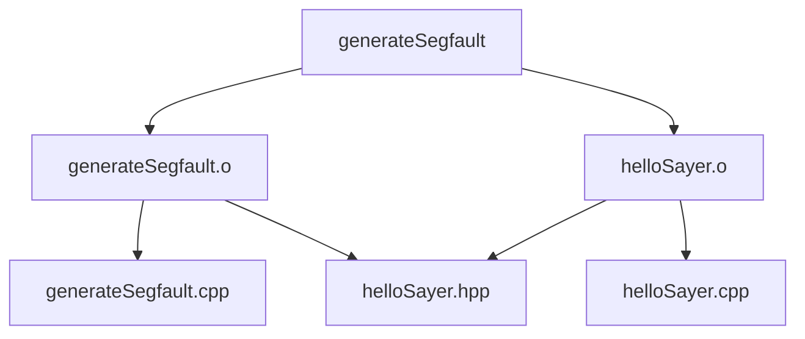

**Build automation** turns a program's source files into its executables by following written rules, and reruns only the steps whose inputs have changed since the last build.

A build is a set of **rules**, each of the form: if any of these **prerequisites** change, then this **target** needs to be updated by running these **commands**. A target is usually a file the commands produce (e.g., an object file or an executable), and its prerequisites are the files it's made from. Since a target can be another rule's prerequisite, the rules form a dependency graph, with source files at the bottom and executables at the top.

To bring a target up to date, the build tool works recursively: it first brings each prerequisite up to date, then reruns the target's commands only if some prerequisite is newer than the target, or the target doesn't exist. A rebuild after a small change reruns only the commands that change affects, which is an **incremental build**. With [[Separate Compilation|separate compilation]], editing one source file recompiles that file and relinks, and editing a header recompiles every file that includes it.

Rules don't have to produce files. A **phony target** names a task rather than a file (e.g., `clean`, which deletes everything the build generated, and `all`, which builds every executable). Since no file has its name, it's never up to date, and its commands run whenever it's asked for.

More generally, the first tool of this kind was Make, written by Stuart Feldman at Bell Labs in 1976, and its Makefiles are still common for C and C++. Make decides what's out of date by comparing file modification times. Later build systems (e.g., CMake, Bazel, and Cargo) generate or replace these rules, and some compare file contents instead of times, so touching a file without changing it doesn't trigger a rebuild. Make's syntax is in [[Makefiles]].

# Examples

## Rebuilding after an Edit

A program `generateSegfault` is built from two source files, and both include `helloSayer.hpp`. Its rules form this dependency graph, with each arrow pointing from a target to a prerequisite:

After an edit to `helloSayer.cpp`, only `helloSayer.o` is older than one of its prerequisites. So a rebuild recompiles `helloSayer.cpp`, then relinks `generateSegfault`, and leaves `generateSegfault.o` alone. An edit to `helloSayer.hpp` makes both object files out of date, so both are recompiled.

# Connections

- [[Separate Compilation]]: the compile and link steps a C++ build automates
- [[Declaration and Definition]]: headers hold declarations, which is why a header is a prerequisite of every file that includes it
- [[uv]]: a Python project manager, which keeps an environment in step with a lock file much as a build keeps targets in step with their sources

# Sources

- [[Data Structures & Program Development (HMC CS70)]]

# Maps

![[Map.base#Maps]]
