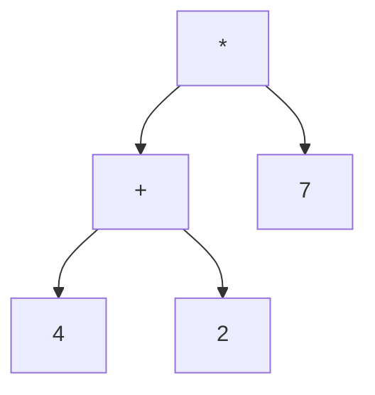

**Concrete syntax** is the text a programmer writes, and **abstract syntax** is the program's structure, represented as a tree with the details of the text left out.

Concrete syntax is a linear sequence of characters. It includes keywords, punctuation, and legal identifiers, and it needs rules to resolve ambiguity (e.g., whether `3 - 7 * 2` subtracts or multiplies first). A grammar specifies it. Abstract syntax is the program as structured data, an **abstract syntax tree** (AST). Exact keywords and punctuation are dropped, and the tree has no ambiguity: its shape already says which operation applies to which operands.

The two are connected in both directions. **Parsing** turns concrete syntax into abstract syntax (see [[Parsing]]), and **pretty printing** turns abstract syntax back into text. Since the tree ignores irrelevant details, many concrete forms map to one tree: `(4 + 2) * 7` with or without extra spaces, in prefix notation, or in a different language's syntax.

Parentheses and [[Operator Precedence and Associativity|precedence]] belong to concrete syntax, not abstract syntax. They exist to tell a reader how to group a flat string. A tree has no need for them, since its nesting is the grouping, so a parenthesis constructor in an AST would be redundant, and could even build nonsense like a right parenthesis on both sides.

More generally, an abstract syntax can be designed well or badly. A good one has a constructor for each kind of construct, without repeating structure or leaving out distinctions that matter (see the example). Most compilers and interpreters work on an AST, since it's far easier to analyze and transform than text.

# Example

`(4 + 2) * 7` as a tree:



The same structure as Haskell data:

```haskell
data Op  = PlusOp | MinusOp | TimesOp | DivOp
data Exp = Num Double | BinOp Exp Op Exp

BinOp (BinOp (Num 4) PlusOp (Num 2)) TimesOp (Num 7)
```

Five ways to design `Exp` for arithmetic:

| Design | Verdict |
|---|---|
| <code>data Exp = Double &#124; Plus Exp Exp &#124; …</code> | Wrong: `Double` becomes a constructor with no value, not a number |
| <code>data Exp = Num Double &#124; Plus Exp Exp &#124; Minus Exp Exp &#124; …</code> | Correct, but repetitive: every function needs a case for each operator |
| <code>data Exp = Num Double &#124; BinOp Exp Op Exp</code> | Good: the operators share one case |
| `type Op = String` | Too abstract: any string could pass as an operator |
| Adding `Parenthesized Paren Exp Paren` | Too concrete: grouping belongs to the text, not the tree |

# Connections

- [[Syntax and Semantics]]: concrete and abstract syntax are the two forms of a language's syntax
- [[Code as Data]]: abstract syntax is code represented as data
- [[Operator Precedence and Associativity]]: rules of concrete syntax, which the tree makes unnecessary
- [[Recursive Data Type]]: an AST is a recursive data type, with expressions inside expressions
- [[Interpreter]]: evaluates the AST, not the text
- [[Parsing]]: how concrete syntax becomes abstract syntax
- [[Context-Free Grammar]]: specifies the concrete syntax, and its parse trees are concrete syntax trees

# Sources

- [[Programming Languages (HMC CS131)]]

# Maps

![[Map.base#Maps]]
