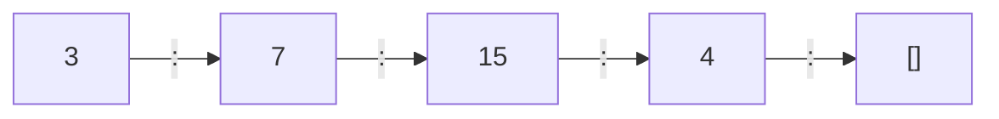

A **cons list** is an immutable, singly linked list built from two constructors: the empty list, and **cons**, which puts an element in front of an existing list.

In Haskell, the empty list is `[]`, cons is the operator `(:)`, and the bracket notation is shorthand: `[3, 7, 15]` means `3 : 7 : 15 : []`. So a list is either:

- **Empty:** `[]`, or
- **An element followed by a list:** `x : xs`, read "`x` consed onto `xs`."

Cons is right-associative, so `3 : 7 : []` means `3 : (7 : [])`: the rightmost cons is applied first. Its right operand must already be a list, so `3 : 7` is an error. Lists are **homogeneous**: every element has the same type, so `3 : xs` requires `xs` to be a list of numbers. A string is a list of characters.

Because a list is a [[Recursive Data Type]], list functions are written with one case for `[]` and one for `x : xs`, and [[Pattern Matching]] on `(x : xs)` takes a list apart into its **head** `x` and **tail** `xs`. Taking the head or tail of an empty list fails (see [[Partial Function]]).

Lists have algebraic properties that help when reasoning about code. The empty list is an identity for concatenation (`xs ++ [] == xs` and `[] ++ xs == xs`), just as 0 is for addition, and `length (xs ++ ys) == length xs + length ys`. With [[Lazy Evaluation]], a list can even be infinite, since only the elements a program uses are ever built.

More generally, the name "cons" comes from Lisp, where `cons` constructs a pair of an element and the rest of a list, and most functional languages build their standard list the same way (e.g., OCaml, Scala, and Clojure). Adding to the front is cheap, since the existing list is shared rather than copied, which is safe because lists never change.

# Example

Building a list, step by step:

```haskell
3 : [7, 15, 4]        -- [3, 7, 15, 4]
3 : 7 : 15 : 4 : []   -- the same list, without brackets
'h' : "ello"          -- "hello"
```



Infinite lists are defined recursively, and only the part that's used is built:

```haskell
ones = 1 : ones         -- [1, 1, 1, …]
take 3 ones             -- [1, 1, 1]
take 5 (map (* 2) [1 ..])  -- [2, 4, 6, 8, 10]
```

# Connections

- [[Recursive Data Type]]: a cons list is the standard example of one
- [[Pattern Matching]]: the pattern `x : xs` takes a list apart the same way `:` builds it
- [[Lazy Evaluation]]: what lets a list be infinite
- [[Map (Higher-Order Function)]] and [[Filter (Higher-Order Function)]]: the two most common operations on lists
- [[Parametric Polymorphism]]: why `(:)` works on lists of every type

# Sources

- [[Programming Languages (HMC CS131)]]

# Maps

![[Map.base#Maps]]
