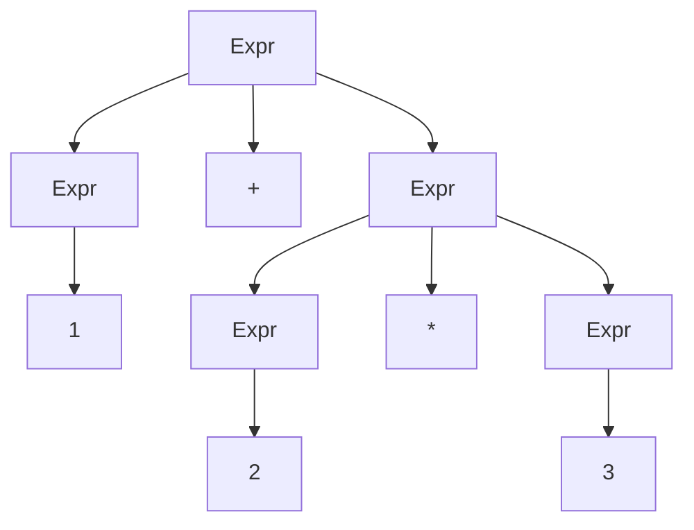

A **context-free grammar** is a set of rules that specifies which sequences of symbols are valid programs in a language, and how each one is built up.

A grammar is a specification for a parser: a program is syntactically valid exactly when the grammar can produce it. It's written as **production rules**, each saying how to produce one kind of phrase:

- **Non-terminal symbols** (e.g., `Expr`, see the [[#A Grammar for Arithmetic|example]]) name kinds of phrases, and each has a rule.
- **Terminal symbols** (e.g., `+`, `(`, and `number`) are the tokens that appear in the program itself (see [[Lexical Analysis]]).
- **Alternatives,** separated by `|`, are the different ways to produce a non-terminal.
- **The start symbol** is the non-terminal a whole program must be (e.g., `Expr`).
- **$\varepsilon$** (epsilon) is an alternative that produces nothing.

Producing a program from the start symbol, one rule at a time, builds a **parse tree** (also called a **concrete syntax tree**): its root is the start symbol, its inner nodes are non-terminals, and its leaves are terminals, which read left to right give the program's text. A parse tree records every detail of the grammar. An abstract syntax tree keeps only the structure that matters (see [[Concrete and Abstract Syntax]]).

A grammar is **ambiguous** when some program has two different parse trees. The simplest grammar for arithmetic is ambiguous: it doesn't say whether `1 + 2 * 3` multiplies first. Rewriting the grammar can remove the ambiguity, building [[Operator Precedence and Associativity|precedence and associativity]] into its rules. A grammar can also need rewriting so that a parser can follow it (see [[Left Recursion]]).

More generally, the `::=` and `|` notation when defining a grammar (see the [[#A Grammar for Arithmetic|example]]) is **Backus–Naur form** (BNF), first used to define ALGOL 60. "Context-free" means each rule applies to a non-terminal regardless of what surrounds it. Context-free grammars sit between regular expressions, which can't describe nested parentheses, and more powerful formalisms in the Chomsky hierarchy. Haskell's `data` declarations follow the same shape as a grammar, with constructors as alternatives (see [[Algebraic Data Type]]).

# Examples

## A Grammar for Arithmetic

A grammar for arithmetic expressions:

```
Expr ::= Expr + Expr
       | Expr - Expr
       | Expr * Expr
       | Expr / Expr
       | number
       | ( Expr )
```

One parse tree for `1 + 2 * 3`, with the multiplication grouped first:



The same grammar also allows a tree that groups `1 + 2` first, so it's ambiguous.

# Connections

- [[Parsing]]: a grammar specifies what a parser accepts
- [[Concrete and Abstract Syntax]]: a parse tree is concrete syntax as a tree, and an AST abstracts it
- [[Operator Precedence and Associativity]]: what an unambiguous arithmetic grammar has to encode
- [[Left Recursion]]: a grammar shape that recursive-descent parsers can't follow
- [[Recursive-Descent Parser]]: a parser written to mirror the grammar
- [[Typing Rule]]: typing rules are written over a grammar of expressions and types

# Sources

- [[Programming Languages (HMC CS131)]]

# Maps

![[Map.base#Maps]]
