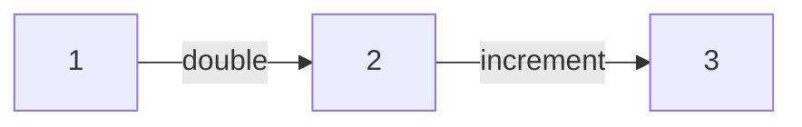

**Function composition** is an operation that combines two functions $g$ and $f$ into a new function $h$, such that $h(x) = g(f(x))$.

In mathematics, the composition is written $g \circ f$, read "$g$ after $f$." The function on the right is applied first, and the function on the left is applied to its result. Composition only works when the types line up: the result type of $f$ must be the parameter type of $g$. Order matters, so $g \circ f$ and $f \circ g$ are usually different functions.

Composition comes out of abstracting a pattern. The expressions `increment (double 1)`, `double (increment 1)`, and `increment (square 1)` (with the three functions defined in the [[#Composing Three Functions|example]]) all apply one function to `1` and then another function to the result. Only the functions differ, so they become parameters, and making the starting value a parameter too gives a general `compose`:

```haskell
compose :: (Integer -> Integer) -> (Integer -> Integer) -> Integer -> Integer
compose g f n = g (f n)
```

`compose` is a [[Higher-Order Function|higher-order function]]: it takes two functions, and since it's curried, `compose increment double` returns a function. Haskell has it built in as the operator `(.)`, with a more general type that lets the three types differ:

```haskell
(.) :: (b -> c) -> (a -> b) -> a -> c
(g . f) x = g (f x)
```

`(.)` is right-associative, so `h . g . f` means `h . (g . f)`, and the rightmost function still runs first. Composition is how larger functions are built from smaller ones without naming the values passed between them (see [[Point-Free Style]]).

More generally, composition is associative: $h \circ (g \circ f)$ and $(h \circ g) \circ f$ are the same function, so a chain needs no parentheses. The identity function $\mathrm{id}(x) = x$ (`id` in Haskell) leaves any function unchanged when composed with it: $f \circ \mathrm{id} = \mathrm{id} \circ f = f$. Other languages write composition left to right instead, in the order the functions run (e.g., F#'s `>>`, or a Unix pipeline like `sort | uniq`, which passes each command's output to the next).

# Examples

## Composing Three Functions

Three small functions:

```haskell
increment, double, square :: Integer -> Integer
increment = (+ 1)
double = (* 2)
square = (^ 2)
```

Composing them in different orders gives different functions:

| Expression | Steps | Value |
|---|---|---|
| `(increment . double) 1` | `double 1` $\to$ `2`, then `increment 2` $\to$ `3` | `3` |
| `(double . increment) 1` | `increment 1` $\to$ `2`, then `double 2` $\to$ `4` | `4` |
| `(increment . square) 1` | `square 1` $\to$ `1`, then `increment 1` $\to$ `2` | `2` |

The first one, as a pipeline:



## Composition with Map and Filter

Composing with map and filter (see [[Higher-Order Function#Examples|Higher-Order Function]]):

```haskell
map (increment . double) [1, 2, 3]              -- [3, 5, 7]
filter (even . increment) [1, 2, 3, 4]          -- [1, 3]
```

# Connections

- [[Higher-Order Function]]: `(.)` takes two functions and returns a function
- [[Point-Free Style]]: composition is the main tool for writing functions without naming their arguments
- [[Currying]]: `(.)`'s type is a chain of arrows, and partial applications like `(+ 1)` are what usually get composed

# Sources

- [[Programming Languages (HMC CS131)]]

# Maps

![[Map.base#Maps]]
