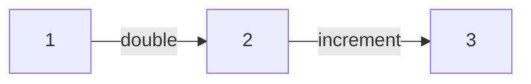

**Function composition** is an operation that combines two functions $g$ and $f$ into a new function $h$, such that $h(x) = g(f(x))$.

In mathematics, the composition is written $g \circ f$, read "$g$ after $f$." The function on the right is applied first, and the function on the left is applied to its result. Composition only works when the types line up: the result type of $f$ must be the parameter type of $g$. Order matters, so $g \circ f$ and $f \circ g$ are usually different functions.

Haskell has composition built in as the operator `(.)`, whose definition is the same as the hand-written `compose` that [[Higher-Order Function]] derives:

```haskell
(.) :: (b -> c) -> (a -> b) -> a -> c
(g . f) x = g (f x)
```

`(.)` is right-associative, so `h . g . f` means `h . (g . f)`, and the rightmost function still runs first. Composition is how larger functions are built from smaller ones without naming the values passed between them (see [[Point-Free Style]]).

# Example

Three small functions:

```haskell
increment, double, square :: Integer -> Integer
increment = (+ 1)
double = (* 2)
square = (^ 2)
```

Composing them in different orders gives different functions:

| Expression | Steps | Value |
|---|---|---|
| `(increment . double) 1` | `double 1` → `2`, then `increment 2` → `3` | `3` |
| `(double . increment) 1` | `increment 1` → `2`, then `double 2` → `4` | `4` |
| `(increment . square) 1` | `square 1` → `1`, then `increment 1` → `2` | `2` |

The first one, as a pipeline:



# Connections

- [[Higher-Order Function]]: `(.)` takes two functions and returns a function
- [[Point-Free Style]]: composition is the main tool for writing functions without naming their arguments
- [[Currying]]: `(.)`'s type is a chain of arrows, and partial applications like `(+ 1)` are what usually get composed

# Sources

- [[Programming Languages (HMC CS131)]]

# Maps

![[Map.base#Maps]]
