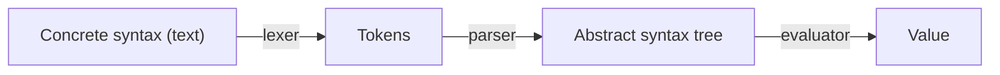

**Parsing** is turning a program's concrete syntax, the text the programmer wrote, into its abstract syntax tree, or reporting that the text isn't a valid program.

A parser has two jobs: check the text for syntax errors, and if there are none, build the AST (see [[Concrete and Abstract Syntax]]). It's the front end of a language implementation. The pipeline runs from text, through the parser, to a tree, and then to an evaluator that gives the tree its meaning (see [[Interpreter]]):



Parsing usually happens in two stages. A lexer first splits the text into tokens (see [[Lexical Analysis]]). The parser then checks the tokens against a grammar, which specifies the valid programs (see [[Context-Free Grammar]]), and builds the tree.

There are four ways to get a parser:

1. **By hand, from scratch** (see [[Recursive-Descent Parser]]).
2. **By hand, using a library** (see [[Parser Combinator]]).
3. **With a parser generator,** which compiles a description of the syntax (e.g., a grammar) into parser code.
4. **With a parser synthesizer,** which builds a parser from examples of valid and invalid programs. This is ongoing research.

More generally, parser generators are common in compilers (e.g., yacc, Bison, and ANTLR), while many production compilers, including those for C, Go, and Rust, use hand-written recursive-descent parsers for better error messages. The reverse direction, from a tree back to text, is **pretty printing**.

# Example

Parsing the text `1 + 2 * 3` into [[Arith]]'s abstract syntax:

```haskell
parse "1 + 2 * 3"
-- BinOp (Num 1) PlusOp (BinOp (Num 2) TimesOp (Num 3))
```

Parsing `1 + * 3` reports a syntax error instead, since no tree fits it.

# Connections

- [[Concrete and Abstract Syntax]]: parsing turns the first into the second
- [[Lexical Analysis]]: the stage before parsing, splitting text into tokens
- [[Context-Free Grammar]]: the specification a parser checks text against
- [[Recursive-Descent Parser]] and [[Parser Combinator]]: two ways to write a parser by hand
- [[Interpreter]]: the back end that evaluates what the parser builds

# Sources

- [[Programming Languages (HMC CS131)]]

# Maps

![[Map.base#Maps]]
