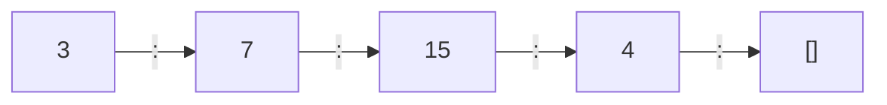
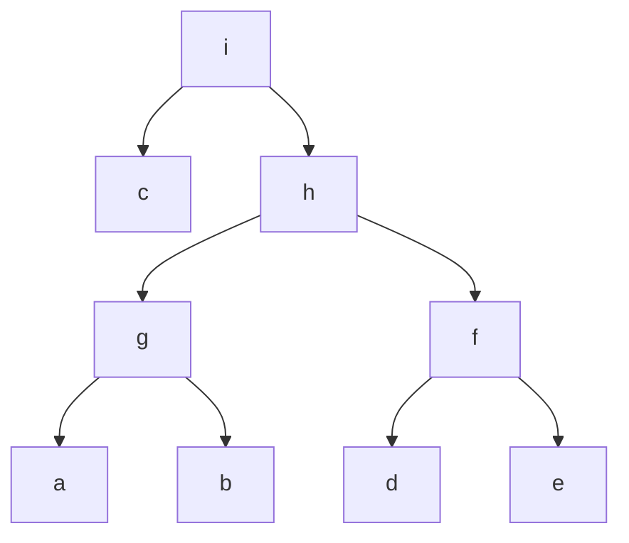

A **recursive data type** is a type whose definition refers to itself, so a value can contain smaller values of the same type.

Every useful recursive type has at least one alternative that doesn't refer to the type, a **base case**, so that values can be finite. A list is either empty, or an element followed by another list. A binary tree is either a leaf, or a node with two smaller trees. As [[Algebraic Data Type|algebraic data types]], these are declared like any other, with the type name appearing among a constructor's fields.

The list is the standard example. It's built from two constructors: the empty list, and **cons**, which puts an element in front of an existing list. In Haskell, the empty list is `[]`, cons is the operator `(:)`, and brackets are shorthand (e.g., `[3, 7, 15]` means `3 : 7 : 15 : []`). [[Pattern Matching]] on `(x : xs)` takes a list apart into its **head** `x` and **tail** `xs`, and since an empty list has neither, `head` and `tail` fail on one (see [[Partial Function]]). Lists also have algebraic properties that help when reasoning about code: the empty list is an identity for concatenation (`xs ++ [] == xs` and `[] ++ xs == xs`), just as 0 is for addition, and `length (xs ++ ys) == length xs + length ys`. With [[Lazy Evaluation]], a list can even be infinite (e.g., `ones = 1 : ones`), since only the elements a program uses are ever built.

Functions over a recursive type follow its shape. Each constructor gets a case, and each recursive field gets a recursive call, so a function over lists has an empty case and a non-empty case, and a function over trees recurs on both subtrees. More generally, this pattern is called **structural recursion** (see [[Recursion]]), and it always terminates on finite values, since each call is on a smaller part. A list built this way is called a **cons list**, after Lisp's `cons`, and most functional languages build their standard list the same way (e.g., OCaml, Scala, and Clojure). Adding to the front is cheap, since the existing list is shared rather than copied, which is safe because the list never changes.

# Example

A list of integers, built from scratch, and its length:

```haskell
data IntList = Empty | Cons Int IntList

intListLength :: IntList -> Int
intListLength Empty       = 0
intListLength (Cons _ xs) = 1 + intListLength xs
```

`Cons 10 (Cons 20 Empty)` is the list of 10 and 20, and its length is `1 + (1 + 0)`. Haskell's built-in lists have the same structure, with `[]` for `Empty` and `:` for `Cons`:

```haskell
3 : [7, 15, 4]        -- [3, 7, 15, 4]
3 : 7 : 15 : 4 : []   -- the same list, without brackets
```



A binary tree of strings, with no empty trees:

```haskell
data StringBinaryTree
  = Leaf String
  | Node String StringBinaryTree StringBinaryTree

treeHeight :: StringBinaryTree -> Int
treeHeight (Leaf _)            = 0
treeHeight (Node _ left right) = 1 + max (treeHeight left) (treeHeight right)

tree7 = Node "i" (Leaf "c")
          (Node "h" (Node "g" (Leaf "a") (Leaf "b"))
                    (Node "f" (Leaf "d") (Leaf "e")))
```



`treeHeight tree7` is `3`, the longest path from `i` down to a leaf.

# Connections

- [[Algebraic Data Type]]: recursive types are algebraic data types that mention themselves
- [[Recursion]]: functions over recursive types are recursive in the same places
- [[Pattern Matching]]: the pattern `x : xs` takes a list apart the same way `:` builds it
- [[Lazy Evaluation]]: what lets a recursive structure like a list be infinite
- [[Parametric Polymorphism]]: `[a]` makes one list type work for elements of every type
- [[Map (Higher-Order Function)]]: mapping works over any recursive structure, not just lists (e.g., applying a function at every node of a tree)
- [[Concrete and Abstract Syntax]]: an abstract syntax tree is a recursive data type, with expressions inside expressions

# Sources

- [[Programming Languages (HMC CS131)]]

# Maps

![[Map.base#Maps]]
