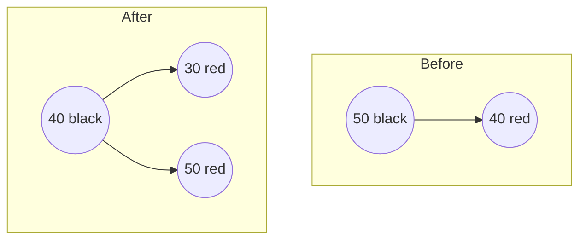

A **red-black tree** is a [[Binary Search Tree|binary search tree]] that represents a [[2-3-4 Tree|2-3-4 tree]], with each node colored red or black to record which nodes belong to the same 2-3-4 node, which keeps its height $\Theta(\log n)$ in the worst case.

Binarizing a 2-3-4 tree splits each 3-node and 4-node into a small BST, with the edges inside each marked. A red-black tree moves that mark from the edge to the node it points into:

- **Black** nodes have no marked edge pointing into them. Each is the top of one 2-3-4 node, whether a 2-node, 3-node, or 4-node.
- **Red** nodes have a marked edge pointing into them. Each is an extra key of a 3-node or 4-node, hanging below that node's black key.

So a 4-node is a black node with two red children, and a 3-node is a black node with one red child, on either side. Three rules follow from that correspondence:

1. **No red node has a red child.** A red node's parent is the black top of its own 2-3-4 node.
2. **The root is black.**
3. **Every path from the root down to an empty subtree passes through the same number of black nodes,** since every path in a 2-3-4 tree passes through the same number of nodes.

These rules bound the height: the shortest path is all black, and the longest alternates black and red, so no path is more than twice as long as another, and the height is $\Theta(\log n)$.

**Insertion** walks down to a leaf as in an ordinary BST, mirroring a 2-3-4 insertion. Along the way, it may change some nodes' colors, which corresponds to promoting a 4-node's middle key, and it may perform a [[Tree Rotation|rotation]], which keeps each 4-node in its proper shape, a black node with a red child on each side. The new key is added as a red node. Lookup and insertion take $O(\log n)$ time in the worst case: a lookup can take $\Theta(1)$ if the key is at the root, and an insertion always takes $\Theta(\log n)$.

Compared with a [[Splay Tree|splay tree]], a red-black tree gives a worst-case bound rather than an amortized one, stores one extra bit, the color, in each node, and rotates only during changes to the tree, not during lookups. It does no better when the same keys are used repeatedly, and it has a reputation for being complicated to implement.

More generally, Rudolf Bayer invented the structure in 1972, and Leonidas Guibas and Robert Sedgewick gave it its colors in 1978. Red-black trees commonly implement C++'s `std::map` and `std::set`, and Java's `TreeMap`. Linux's Completely Fair Scheduler kept its runnable tasks in one. Deletion, which also uses recoloring and rotations, is the notoriously intricate part. The AVL tree is the main alternative with worst-case guarantees: more strictly balanced, so faster to search, but with more rotations on insertion.

# Examples

## Inserting into a 3-Node

A black $50$ with a red left child $40$ is the 3-node $[40, 50]$. Inserting $30$ puts it in $40$'s left subtree, as a red node:

Now red $30$ would be the child of red $40$, breaking rule 1, so a right rotation on $50$ raises $40$, and recoloring makes $40$ black and $30$ and $50$ red. The result is a black node with a red child on each side, the 4-node $[30, 40, 50]$: in the 2-3-4 tree, the 3-node gained a key and became a 4-node.

# Connections

- [[2-3-4 Tree]]: the tree a red-black tree represents
- [[Binary Search Tree]]: a red-black tree is one, so lookup needs no changes
- [[Tree Rotation]]: keeps each 4-node's shape during insertion
- [[Splay Tree]]: the amortized alternative
- [[Associative Array]]: red-black trees implement many standard libraries' ordered maps

# Sources

- [[Data Structures & Program Development (HMC CS70)]]

# Maps

![[Map.base#Maps]]
