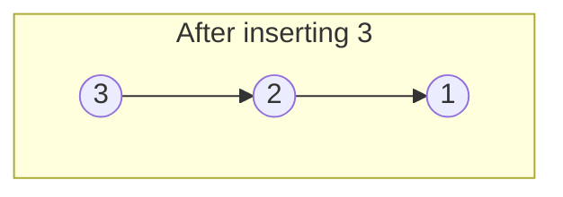

A **splay tree** is a [[Binary Search Tree|binary search tree]] that moves every key it inserts or finds to the root, which makes recently used keys cheap to reach and keeps the tree balanced in an amortized sense.

A splay tree inserts a key as an ordinary BST does, then performs the **splay operation**: a series of [[Tree Rotation|rotations]] that moves the new key to the root. A successful lookup splays the key it found to the root too. The splay operation uses double rotations: when the node and its parent are both left children, or both right children, it rotates on the grandparent first and then on the parent. This choice is what makes the amortized bound hold (see [[Tree Rotation#Moving a Node to the Root|Tree Rotation]]).

The idea is **temporal locality**: a key used recently is likely to be used again soon. Since splaying puts recently inserted or found keys at or near the root, looking them up again takes close to the best case.

A splay tree makes no promise about any one operation. It can become a stick, and the next lookup at the bottom of it takes $\Theta(n)$, a worst case that's easy to trigger (e.g., by inserting keys in sorted order). But that can't be exploited repeatedly, since each expensive operation splays a deep key to the top and leaves the tree better balanced. So insert and lookup take $O(\log n)$ [[Amortized Analysis|amortized time]]: $n$ inserts into an empty tree take $O(n \log n)$ time in all, and in sorted order they take only $\Theta(n)$, with the balancing deferred until later.

Compared with a [[Red-Black Tree|red-black tree]]:

- **Memory:** a splay tree stores nothing extra in its nodes, while a red-black tree stores each node's color.
- **Time:** a splay tree rotates all the way to the root on every insertion and lookup, while a red-black tree rotates only a few nodes, and only when the tree changes.
- **Simplicity:** splay trees are considerably simpler to implement.
- **Locality:** splay trees do best with temporal locality, and red-black trees do no better with it.

More generally, Daniel Sleator and Robert Tarjan invented splay trees in 1985, and proved the amortized bound with the potential method. Splay trees are used where access patterns are skewed, as in caches, memory allocators, and some network routers. Their weakness is that even lookups change the tree, which makes them awkward to share between threads.

# Examples

## Inserting in Order

For illustration (an example not from the source), inserting $1$, $2$, and $3$ in that order. Each new key goes in as the right child of the root, the previous maximum, and one rotation splays it to the root:

The tree is now a stick leaning left, and each insertion cost $\Theta(1)$. Inserting $1$ through $n$ the same way builds a stick of $n$ keys in $\Theta(n)$ time in all. Looking up $1$, at the bottom, then costs $\Theta(n)$, but that lookup's double rotations bring $1$ to the root and roughly halve the depth of every node on the path, so later lookups are cheaper.

# Connections

- [[Binary Search Tree]]: the structure being kept balanced
- [[Tree Rotation]]: the double rotations of the splay operation
- [[Amortized Analysis]]: the guarantee a splay tree gives
- [[Red-Black Tree]]: the worst-case alternative, with more memory and less rotation
- [[Randomized Binary Search Tree]]: the expected-case alternative

# Sources

- [[Data Structures & Program Development (HMC CS70)]]

# Maps

![[Map.base#Maps]]
