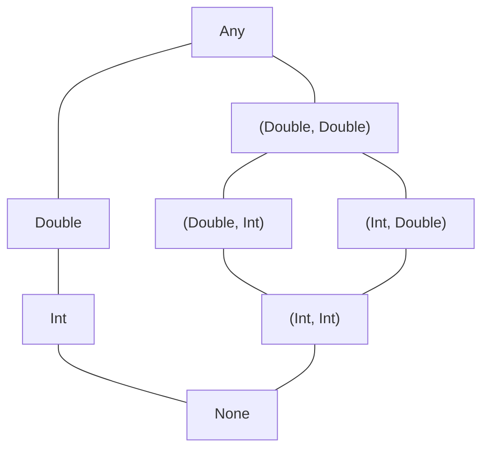

The **top type** is a supertype of every type, and the **bottom type** is a subtype of every type, with no values at all.

Some type systems name them **Any** (the top) and **None** (the bottom). Any is so general that it's useless in practice: a function that returns an Any says nothing about what it returns. None is the subtype version of the empty set. No value has type None, so saying something has type None is vacuously true, which is what lets None sit below every type.

The subtype relationships among a set of types can be drawn as a **type lattice**, a graph where a lower type connected to a higher one is its subtype. Any is at the top, None is at the bottom, and every other type is somewhere in between (see [[Subtyping]]).

More generally, many languages have a top type (e.g., Java's `Object`, TypeScript's `unknown`, and Scala's `Any`) and some have a bottom type (e.g., TypeScript's `never`, Rust's `!`, Scala's `Nothing`, and Haskell's `Void`). A bottom type is the type of computations that never return a value, such as one that throws an error or loops forever. Python's `None` is unrelated: it's a single ordinary value with its own type, closer to Haskell's unit `()`. In order theory, a lattice requires every pair of elements to have a least upper bound and a greatest lower bound, which Any and None help guarantee.

# Example

A type lattice with Any and None:

`Int` is a subtype of `Double`, and `(Int, Int)` is a subtype of both mixed pairs, which are subtypes of `(Double, Double)`.

# Connections

- [[Subtyping]]: the relation a type lattice draws
- [[Type System]]: Any and None are the extremes of a type system with subtyping
- [[Option Type]]: a safer way than a catch-all type to say a value might be missing

# Sources

- [[Programming Languages (HMC CS131)]]

# Maps

![[Map.base#Maps]]
