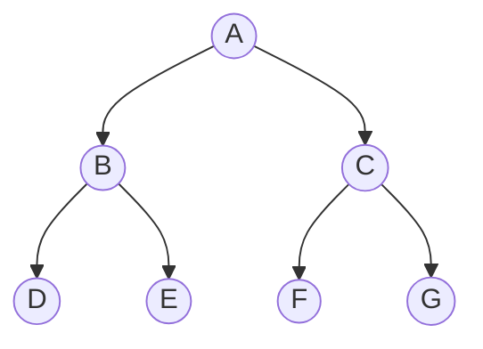

A **tree** is a collection of **nodes** connected by **edges**, with one node at the top, the **root**, and every other node reachable from the root by exactly one path.

Trees come with a vocabulary of their own:

- **Edge:** a connection from one node to another. In an edge from $A$ to $B$, $A$ is the **parent**, where the edge starts, and $B$ is the **child**, where it leads.
- **Root:** the topmost node, the only one with no parent.
- **Leaf:** a node with no children.
- **Subtree:** a node together with all of its descendants (i.e., its children, their children, and so on). It's a tree in its own right, rooted at that node.
- **Height:** the length, in edges, of the longest path from the root to a leaf. A tree with one node has height $0$, and the empty tree has height $-1$.

A **binary tree** is a tree in which every node has at most two children, a **left child** and a **right child**. The two are ordered: a node with only one child has either a left child or a right child, and the two trees are different. Recursively, a binary tree is either *empty*, or a *node* with a left subtree and a right subtree, either of which may be empty.

A binary tree is **balanced** when every node's left and right subtrees have similar heights. A balanced binary tree of $n$ nodes has height $\Theta(\log n)$, the least possible, since each level holds up to twice as many nodes as the level above it. At the other extreme, a **stick**, where every node has at most one child, has height $\Theta(n)$ and is really a linked list. Since operations on a tree usually walk a path from the root, its height decides how long they take (see [[Binary Search Tree]]).

More generally, trees appear far beyond search: abstract syntax trees represent programs (see [[Concrete and Abstract Syntax]]), file systems are trees of folders, and heaps are binary trees with an ordering property. In graph theory, a tree is a connected graph with no cycles, and a rooted tree adds a chosen root. Some authors count height in nodes rather than edges, so a one-node tree has height $1$. In functional languages, a binary tree is a [[Recursive Data Type|recursive data type]], defined exactly as the recursive definition above.

# Example

For illustration (an example not from the source), a binary tree of seven nodes:

`A` is the root, `D`, `E`, `F`, and `G` are leaves, and `B` with `D` and `E` is the subtree rooted at `B`. The longest path from the root to a leaf, such as `A` to `D`, has two edges, so the tree has height $2$. Every node's two subtrees have equal heights, so it's perfectly balanced, and $7 = 2^3 - 1$ nodes fit in height $2 = \log_2 (7 + 1) - 1$.

# Connections

- [[Binary Search Tree]]: a binary tree ordered so it can be searched
- [[Tree Rotation]]: rearranging a binary tree while keeping its order
- [[Recursive Data Type]]: a tree is empty, or a node with subtrees
- [[Linked List]]: what an unbalanced binary tree degenerates into
- [[Concrete and Abstract Syntax]]: abstract syntax trees
- [[Binary Heap]]: a complete binary tree, ordered from top to bottom

# Sources

- [[Data Structures & Program Development (HMC CS70)]]

# Maps

![[Map.base#Maps]]
