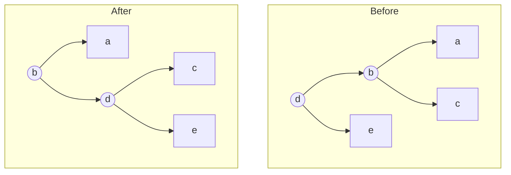

A **tree rotation** rearranges a node and one of its children in a [[Binary Search Tree|binary search tree]] so that the child takes the node's place, while keeping every key in order.

Two nodes are involved: the root of the tree or subtree being rotated, and one of its children, which becomes the new root. A **right rotation** on a node raises its left child, and a **left rotation** raises its right child. Each undoes the other. A rotation preserves the BST ordering because it keeps three things in place:

- The old root becomes the new root's child, on the correct side.
- The subtree that lies *between* the old root and the new root in order stays between them, moving from one to the other.
- The subtrees all the way to the left and all the way to the right stay where they are.

A rotation changes a few pointers, so it takes constant time. It changes the heights of the subtrees involved, which is what makes it useful: every balancing strategy for BSTs reshapes the tree with rotations.

## Moving a Node to the Root

Repeated rotations raise a node one level at a time. **Insert-at-root** inserts a key as a leaf, as usual, then rotates on the new node's parent, over and over, until it reaches the root. A [[Randomized Binary Search Tree|randomized BST]] uses it.

A [[Splay Tree|splay tree]] moves a node up two levels at a time with **double rotations**. When the node and its parent are both left children, or both right children, it rotates first on the grandparent and then on the parent, the reverse of insert-at-root's order. When one is a left child and the other a right child, it rotates on the parent and then on the grandparent, just as insert-at-root would. The first case is what makes a splay tree different: rotating the grandparent first roughly halves the depth of every node on the path, rather than leaving the path as deep as it was.

More generally, rotations are the common tool of balanced trees, including AVL trees (1962, the first self-balancing BST), red-black trees, and splay trees. Some authors name a rotation by the direction the parent moves, so the same operation can be called left or right in different texts.

# Examples

## A Right Rotation

A right rotation on the node containing $d$, with $b$ as its left child and $a$, $c$, and $e$ as subtrees:

In order, the tree reads $a, b, c, d, e$ both before and after. $b$ becomes the root, $d$ becomes its right child, and $c$, which lies between $b$ and $d$, moves from $b$'s right to $d$'s left. $a$ stays leftmost and $e$ rightmost. A left rotation on $b$ in the second tree gives back the first.

# Connections

- [[Binary Search Tree]]: the ordering every rotation preserves
- [[Randomized Binary Search Tree]]: insert-at-root, by single rotations
- [[Splay Tree]]: double rotations, which give its amortized bound
- [[Red-Black Tree]]: rotations keep each 4-node's shape during insertion

# Sources

- [[Data Structures & Program Development (HMC CS70)]]

# Maps

![[Map.base#Maps]]
